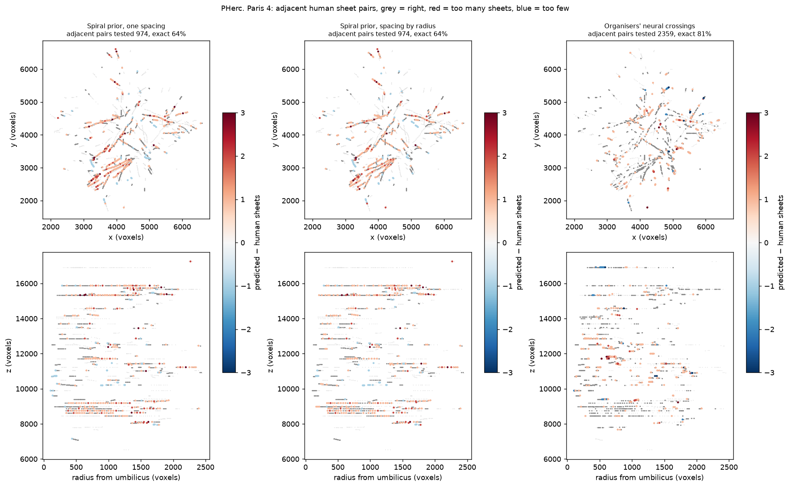

# A scorer for automatic winding constraints

**Question.** How right is a winding-constraint generator, measured against the human winding
annotations of PHerc. Paris 4? I wanted one instrument that any generator (mine, the organisers'
neural crossings, a plain spiral prior) can be run through, with the same numbers out.

**Truth.** `spiral_datasets/PHercParis4/relative_windings.json`: 254 human radial chains,
2,173 clicks; `wind_a` counts sheets along each chain. `wind_a` is relative **within a chain
only** (each chain restarts at 1), so the truth is the 16,269 within-chain pairs. Only Paris 4
has public human winding labels, so this is a single-scroll instrument for now.

**Method.** `tools/windingcheck`. A candidate point matches a human click when it is on the same
sheet: within `tol_n` along the human chain's direction (roughly the sheet normal) and within
`tol_t` = 25 voxels along the sheet. `tol_n` = 0.35 × the local sheet spacing on that chain,
clipped to [1.5, 4] voxels, so a point cannot match two adjacent sheets. Each pair of candidate
points from one candidate chain that match two clicks of one human chain is a **test**:
predicted Δw against human Δw. Spiral priors are evaluated at every click directly.

## Run

    python experiments/2026-10-12-winding-scorer/run.py

CPU only, 11 s, 2.8 GB peak RAM. Writes `results.json` and `drift_map.png`.

## Does the scorer work?

I fixed these checks and their thresholds before the first run.

- **Human chains against themselves:** 100.0% exact, 100.0% of 16,269 pairs covered.
- **Levels shuffled within each chain:** 10.4% exact on adjacent pairs (the check asked for
  under 30%).
- **One missed sheet added to every chain with ≥ 4 clicks:** 48.12% exact, exactly the expected
  fraction, no sign errors.
- **Cost:** 22.7 M crossings scored in 9.4 s at 2.8 GB.
- **Do the human files agree with each other?** I could not test this. The public
  `same_windings.json` collections sit almost entirely away from the relative chains: 13 links,
  no closed loops. The truth is used as given.

## Three baselines

The spiral priors are fitted on the even-numbered chains and scored on the odd ones; the
crossings have no fit and are scored on all chains.

| Method | Tests | Human pairs covered | Exact | ±1 | Sign errors | Exact, adjacent | Exact, \|Δw\| ≥ 8 |
|---|---|---|---|---|---|---|---|
| spiral prior, one spacing (17.8 vx) | 9,142 | 100% (held-out) | 19.1% | 38.6% | 0 | 64.1% | 4.4% |
| spiral prior, spacing by radius | 9,142 | 100% (held-out) | 18.9% | 40.1% | 0 | 63.9% | 4.8% |
| organisers' neural crossings | 5,298 | **16.3%** (2,659 pairs); 53% of adjacent | **75.8%** | 93.8% | 1.8% | 80.5% | 64.2% (53 tests) |

On the same held-out pairs with |Δw| ≥ 4: crossings 79.1% exact (387 tests), the one-spacing
prior 29.8% (245 pairs).

`drift_map.png`: every adjacent human pair, grey where the method is right, red where it counts
too many sheets, blue too few. Panels, left to right: the
one-spacing prior, the prior with spacing by radius, the organisers' crossings. Top row x/y,
bottom row radius/z.

Before the run I wrote down five guesses. Three were right (the prior is under 50% exact on all
pairs; the crossings cover under half the human pairs; the crossings beat the prior on far
pairs). Two were wrong: the one-spacing prior is 64.1% exact on adjacent pairs, not ≥ 70%, and
spacing by radius does not help (18.9% against 19.1%).

## What it means

- The scorer is exact on itself, collapses on shuffled labels and catches a missed sheet at
  the expected rate. Any VC3D winding file can be scored in seconds on a laptop.
- A spiral prior is not a usable winding source: one pair in five exact. Spacing by radius does
  not help, so the error comes from local compression, not from a radius trend.
- The organisers' neural crossings are the bar for any new generator: 76% exact, 94% within ±1,
  but they reach only 16% of the human pairs. Of their 459 wrong adjacent tests, **91.3% count
  one sheet too many** and 8.7% too few, and they sit in clusters (red in the drift map), not as
  scattered noise. One guess is that an opened sheet join or a split sheet looks like two wraps
  there; I have not tested that.
- This tool saves no clicks by itself. It measures a generator in human-chain equivalents.
  Paris 4's relative chains cost 3.5–7.0 h of clicking (`../2026-10-12-winding-human-baseline/`).
